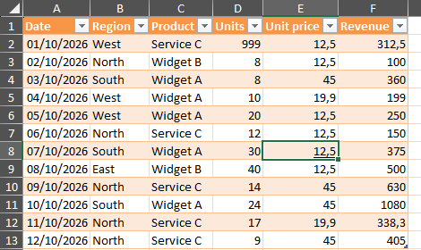
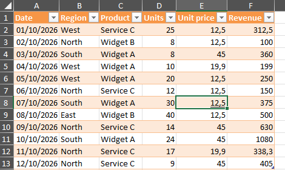
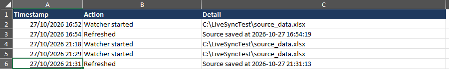

# Excel Live Sync from a local file (Power Query + VBA)

A workbook that mirrors another Excel or CSV file on the same computer and refreshes itself a few seconds after that source file is saved. No buttons to press and no Windows scheduled tasks: the user just opens the workbook and watches the figures change.

> Demo data only. The sample sales figures are fictitious.

## How it works

```
Source file saved (Excel or CSV)
  → every 2 seconds the macro reads the file's "last saved" time
  → when it changes, the Power Query table is refreshed
  → Settings!LastRefresh and the Log sheet record the run
```

- **Power Query** reads the source. The path comes from one cell (`SourcePath`), so files can be moved or renamed without editing the query.
- **A small VBA module** (`LiveSync.bas`) checks the source's save time with `Application.OnTime`. It only marks a change as done after a successful refresh, so a file that was still being written is simply retried on the next check.
- Works with `.xlsx` and `.csv` sources on Windows 10/11 with Excel 365. No add-ins or paid software.

## Files

| File | Purpose |
|---|---|
| `template/LiveSync_Template.xlsx` | Workbook with Data, Settings and Log sheets and the named cells used by the query and the macro |
| `src/SourceData.pq` | Power Query (M) code for the `SourceData` query |
| `src/LiveSync.bas` | VBA module: watcher, refresh and log |
| `src/ThisWorkbook.txt` | Code for the ThisWorkbook object (start on open, stop on close) |
| `sample/source_data.xlsx`, `sample/source_data.csv` | Sample source files |

## Setup (about 10 minutes)

1. Put the template and `source_data.xlsx` in the same folder (a local folder, not a synced cloud folder).
2. Open the template and **Save As** `LiveSync.xlsm` (Excel Macro-Enabled Workbook) in that folder.
3. **Data > Get Data > From Other Sources > Blank Query**. In **Advanced Editor**, paste `src/SourceData.pq`. Rename the query to `SourceData`. **Close & Load To...** a table on the `Data` sheet.
   - If Excel shows a *Formula.Firewall* message: **Data > Get Data > Query Options > Current Workbook > Privacy > Ignore the Privacy Levels**.
4. Press **Alt+F11**. **File > Import File...** and choose `src/LiveSync.bas`. Double-click **ThisWorkbook** and paste the code from `src/ThisWorkbook.txt`. Save.
5. To avoid the macro security bar: **File > Options > Trust Center > Trust Center Settings > Trusted Locations > Add new location** and add the folder.
6. Close and reopen `LiveSync.xlsm`. The Log sheet shows "Watcher started".

**Test:** open `source_data.xlsx`, change a number and press **Ctrl+S**. Within a few seconds `LiveSync.xlsm` shows the new value and the Log sheet records "Refreshed".

**Good to know:** Excel pauses macros while a cell is being edited (status bar shows "Edit"/"Enter"). The refresh runs as soon as the edit is finished. Empty rows and columns in the source are ignored, and a `Date` column is shown as a date.

**Moving or renaming the source:** change `Settings!SourcePath` (a file name for the same folder, or a full path such as `C:\Reports\sales.csv`). The watcher picks up the new path on its next check.

## Tested result

Tested on Windows with Excel 365. The first row's Units was changed from 999 to 25 in `source_data.xlsx` and saved; the workbook refreshed itself about 4 seconds later (source saved 21:31:13, refresh logged 21:31:17).

| Before | After the source was saved |
|---|---|
|  |  |



## Author

Rodrigo Matoso: real estate appraiser and broker (Brazil), building spreadsheet and automation tools with AI-assisted coding.

## License

MIT
